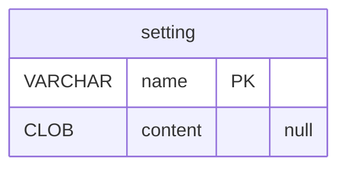

# The application: `app`

`app.mv.db` — The application's own database, one of it: its settings and the settings and job states of every source.

| Table | What it holds |
|---|---|
| `setting` | a setting by its name ("encoder.text", "source.<id>.…", "job.<id>.running"), its value as text |

The diagram is made of the migrations by `SchemaDocsTest`: change it with them.

