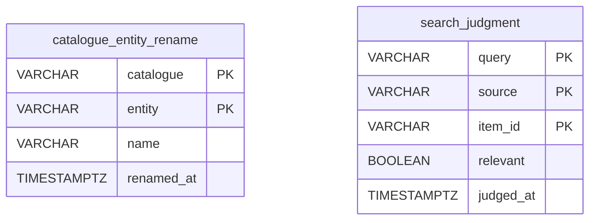

# The user's preferences: `preferences`

`preferences.mv.db` — The user's preferences, every content type's: the names the user gives the entities of a catalogue over the catalogue's, the user's word on what a search found. Backed up on every start.

| Table | What it holds |
|---|---|
| `catalogue_entity_rename` | the name the user gives an entity of a catalogue — a universe, a character of Wikidata — shown in its place everywhere |
| `search_judgment` | the user's word on whether a work found by a line searched is relevant |

The diagram is made of the migrations by `SchemaDocsTest`: change it with them.

