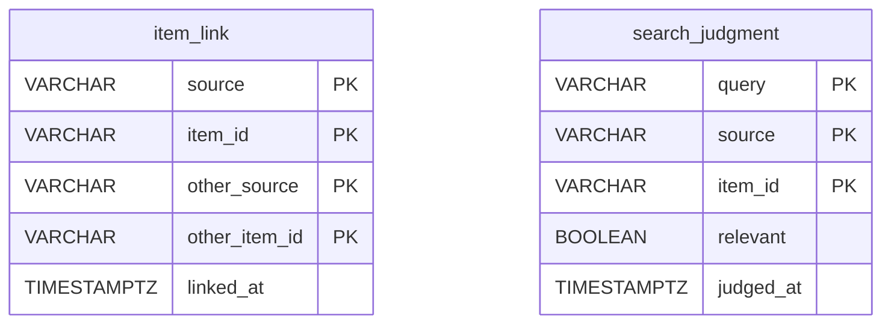

# A content type's corrections: `typecorrections`

`types/<type>/corrections.mv.db` — The user's word across the sources of one content type. Backed up on every start.

| Table | What it holds |
|---|---|
| `item_link` | two works of two sources of the type the user said are one |
| `search_judgment` | the user's word on whether a work found by a line searched is relevant |

The diagram is made of the migrations by `SchemaDocsTest`: change it with them.

